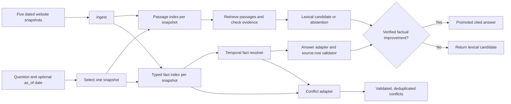

# Knowledge Assignment

This submission answers questions and discovers conflicts from five dated credit-union website snapshots. It is a deterministic, standard-library Python system targeting Python 3.11. It makes no network or LLM calls and needs no API key.

The submitted implementation is in `solution/`. The repository includes the supplied harness and starter interface, while the private participant kit supplies `eval/`, `snapshots/` or `snapshots_zip/`, and the assignment PDF. The private data is excluded from Git and must not be redistributed.

## How it works



`solution/solution.py` implements the `build()`, `ingest()`, `answer()`, and `conflicts()` contract in `harness/contract.py`. Ingestion builds a separate lexical index and typed fact index for each full snapshot. An `as_of` question selects the latest snapshot no later than the requested date. The answer pipeline retrieves passages, checks question qualifiers and evidence sufficiency, and selectively promotes a resolver proposal only after row, measure, schedule, citation, and rendered-answer validation. Unsupported or ambiguous questions retain the lexical fallback, including abstention.

`solution/facts.py` extracts structured rates, terms, tiers, auto APRs, selected fees, branch schedules, and dated numerical claims with provenance. `solution/resolver.py` keeps temporal applicability and source authority decisions separate from extraction. `solution/conflict_adapter.py` validates source rows and disclosures before returning deduplicated simultaneous or stale-published conflicts. It leaves historical changes and unresolved comparisons out of the public conflict list. An unresolved simultaneous disagreement has `resolution=None`; a stale-published disagreement cites the verified current source. Conflict discovery is conservative and does not cover every prose or website conflict category.

## Run locally

From the repository root, use Python 3.11 and place the private snapshot and evaluation data at `snapshots/` (or `snapshots_zip/`) and `eval/public_eval.jsonl`. No third-party packages are needed. Run the public evaluation command:

```bash
python harness/run_eval.py --submission solution --eval eval/public_eval.jsonl
```

The harness writes `results/report.json` and `results/per_question.jsonl`. Runtime uses only the Python standard library. `pytest` is optional development tooling for the function-style tests and is not a submission dependency. The submission has been verified with isolated Python 3.12; Python 3.11 is the target runtime. The latest public-kit QA score is **0.7698** across 40 questions; public-kit conflict accuracy is unmeasured because no conflict gold file is supplied. See `solution/NOTES.md` for implementation limits.
